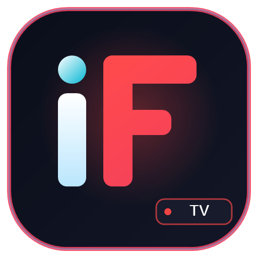

<div align="center">



# 🎬 iFilm TV
### All-In-One Cross-Platform Entertainment Application

[](https://github.com/milonhasanx21/ifilm-tv-app/releases/latest)
[](https://github.com/milonhasanx21/ifilm-tv-app/releases)
[](https://github.com/milonhasanx21/ifilm-tv-app)

**iFilm TV** is a premier entertainment and media streaming application built to deliver a smooth, high-fidelity experience across **Android**, **iOS (iPhone/iPad)**, **Windows**, and **Linux**.

[📥 Direct Downloads](#-direct-downloads) • [✨ Key Features](#-key-features) • [📱 Installation Guide](#-installation-guide)

</div>

---

## 📥 Direct Downloads

Download the latest version (**v15.0.5**) for your device below:

| Platform | Supported Devices | Package | Direct Download Link |
| :--- | :--- | :--- | :--- |
| 🍏 **iOS / iPadOS** | iPhone & iPad (iOS 15.1+) | `.ipa` (18 MB) | [Download for iOS (IPA)](https://github.com/milonhasanx21/ifilm-tv-app/releases/download/v15.0.5/iFilm_TV_15.0.5.ipa) |
| 🤖 **Android Mobile** | Android Phones & Tablets | `.apk` (91 MB) | [Download for Android (APK)](https://github.com/milonhasanx21/ifilm-tv-app/releases/download/v15.0.5/iFilm_TV_Native_v15.0.5_Release.apk) |
| 📺 **Android TV / FireStick** | Android TV, Google TV, Fire OS | `.apk` (91 MB) | [Download for Smart TV (APK)](https://github.com/milonhasanx21/ifilm-tv-app/releases/download/v15.0.5/iFilm_TV_Native_v15.0.5_Release.apk) |
| 💻 **Windows PC** | Windows 10 & Windows 11 (64-bit) | `.exe` (83 MB) | [Download for Windows (Setup)](https://github.com/milonhasanx21/ifilm-tv-app/releases/download/v15.0.5/iFilm_TV_12.0.1_x64-setup.exe) |
| 🐧 **Linux (Universal)** | Ubuntu, Debian, Arch, Fedora | `.AppImage` (181 MB) | [Download for Linux (AppImage)](https://github.com/milonhasanx21/ifilm-tv-app/releases/download/v15.0.5/iFilm_TV_12.0.1_amd64.AppImage) |
| 🐧 **Linux (Debian / Ubuntu)** | Ubuntu, Linux Mint, Debian | `.deb` (115 MB) | [Download for Linux (.deb)](https://github.com/milonhasanx21/ifilm-tv-app/releases/download/v15.0.5/iFilm_TV_12.0.1_amd64.deb) |

---

## ✨ Key Features

- ⚡ **Ultra-Fast Streaming Engine:** Hardware-accelerated video decoding supporting multi-quality HD, FHD, and 4K playback.
- 📺 **Wireless TV Casting:** Stream directly to Smart TVs, Chromecast, and DLNA receivers with dual audio and subtitle switching.
- 🎮 **Leanback TV Remote Navigation:** Clean 10-foot interface designed specifically for TV remotes and game controllers.
- 💾 **Offline Download Manager:** Background downloading with pause, resume, and custom storage folder options.
- 🌙 **Modern Dark Aesthetics:** Eye-friendly dark theme, fluid glassmorphic UI, and optimized battery usage.
- 🎯 **Privacy & Security:** Lightweight, completely free, and without intrusive trackers or telemetry.

---

## 📱 Installation Guide

### 🍏 iOS (iPhone & iPad)
1. Download `iFilm_TV_15.0.5.ipa` on your computer.
2. Install via **Sideloadly** (Free on Windows/Mac):
   - Connect your iPhone to your PC via USB.
   - Open Sideloadly and drag `iFilm_TV_15.0.5.ipa` into the application.
   - Enter your Apple ID and click **Start**.
   - On your iPhone, go to **Settings > General > VPN & Device Management** and select **Trust** on your developer certificate.
   - Enable **Developer Mode** under **Settings > Privacy & Security > Developer Mode** and restart the device.
3. *Alternative:* If you have **Scarlet** or **TrollStore** installed on your iPhone, you can install the `.ipa` file directly on device.

---

### 🤖 Android (Smartphones & Tablets)
1. Download `iFilm_TV_Native_v15.0.5_Release.apk` directly to your phone.
2. Tap the file to install (allow "Install unknown apps" in your browser settings if asked).
3. Open **iFilm TV** and start enjoying your favorite media!

---

### 📺 Android TV & Amazon Fire TV Stick
1. Install the **Downloader** app from the Google Play Store or Amazon Appstore.
2. Open Downloader and enter the direct APK download URL, or transfer `iFilm_TV_Native_v15.0.5_Release.apk` using the **Send Files to TV (SFTV)** app.
3. Click Install and launch iFilm TV directly from your TV apps screen.

---

### 💻 Windows (PC & Laptop)
1. Download `iFilm_TV_12.0.1_x64-setup.exe`.
2. Double-click the installer and follow the quick setup wizard.
3. Launch **iFilm TV** from your Desktop shortcut or Start Menu.

---

### 🐧 Linux
- **AppImage (All Linux Distros):**
  ```bash
  chmod +x iFilm_TV_12.0.1_amd64.AppImage
  ./iFilm_TV_12.0.1_amd64.AppImage
  ```
- **Debian / Ubuntu (.deb):**
  ```bash
  sudo dpkg -i iFilm_TV_12.0.1_amd64.deb
  sudo apt-get install -f
  ```

---

## ⚖️ Legal Disclaimer

> [!NOTE]
> **iFilm TV** is an independent media player and frontend application. It does not host, store, stream, or distribute any media content directly. All content accessed through the app is sourced independently by the end-user via personal media libraries or third-party extensions.
